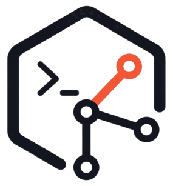

[Study AI Lab 메인](https://www.studyailab.com)에 접속한 뒤 Development Lab을 엽니다. PART와 장을 고른 뒤 커맨드·소스/검증·튜터·자료실을 찾습니다. 이 저장소는 연결된 파일 자료를 제공합니다.

develop-like-a-pro-with-ai는 《프로처럼 AI로 코딩 없이 개발하기》의 독자용 공식 실습 자료 저장소입니다.

[책 튜터](tutor/README.md)를 연결하면 **“다음 요청문 보여줘”**로 현재 단계의 요청문을 찾고, 확인한 뒤 **“진행해”**로 해당 작업을 이어갈 수 있습니다.

## 자료 구성

### 장별 자료

[chapters/](chapters/)에 장별 폴더가 있습니다. 각 장의 README에 그 장의 자료가 무엇이고 언제 쓰는지 적어두었습니다. 장이 아닌 지면에도 입력하는 문장이 있으면 같은 자리에 폴더를 두었고, 그 폴더에는 prompts.md만 있습니다.

| 이름 | 무엇인가 |
|---|---|
| prompts.md | 그 자리에서 Claude Code에 입력하는 문장. 책에 나오는 순서 |
| source/ | 그 장을 끝낸 상태의 프로젝트 전체 |

- [이 책을 읽는 법](chapters/how-to-read/prompts.md)
- [준비편. Claude Code에 첫 일을 맡길 준비를 합니다](chapters/getting-started/prompts.md)
- [1장. 영화 흥행 기록으로 첫 Excel 보고서를 만들어봅니다](chapters/ch01/)
- [2장. Claude가 제대로 만들었는지 확인합니다](chapters/ch02/)
- [3장. 문제가 생기면, 고치기 전에 원인부터 찾습니다](chapters/ch03/)
- [4장. 같은 실수는 두 번 하지 않게 합니다](chapters/ch04/)
- [5장. 잘되던 때로 돌아갈 곳을 만들어둡니다](chapters/ch05/)
- [PART 1 피날레. 이번 PART에서 달라진 것](chapters/part-01-finale/prompts.md)
- [6장. 아파트 실거래가와 위치 정보를 가져옵니다](chapters/ch06/)
- [7장. 내 조건에 맞는 아파트를 찾습니다](chapters/ch07/)
- [8장. 누구나 사용할 수 있는 아파트 찾기 서비스를 만듭니다](chapters/ch08/)
- [9장. 국내 증시와 궁금한 종목을 한눈에 봅니다](chapters/ch09/)
- [10장. 이 회사는 최근 무엇을 공시했을까?](chapters/ch10/)
- [11장. 주가부터 공시까지, AI가 한 번에 브리핑합니다](chapters/ch11/)
- [12장. 더 빠르고 비용은 적게 드는 서비스로 개선합니다](chapters/ch12/)
- [13장. 웹서비스를 앱으로 만들기 전에 알아야 할 것들](chapters/ch13/)
- [14장. 만든 서비스를 Android 앱으로 만듭니다](chapters/ch14/)
- [15장. 같은 서비스를 iPhone 앱으로 만듭니다](chapters/ch15/)
- [16장. AI와 YouTube 영상을 만듭니다](chapters/ch16/)
- [17장. 올리기 전에 AI가 영상을 검사합니다](chapters/ch17/)
- [18장. 만든 영상을 실제 YouTube에 올립니다](chapters/ch18/)
- [19장. AI가 내 유튜브 댓글을 읽고 답글을 준비합니다](chapters/ch19/)
- [20장. 허용한 댓글에만 자동으로 답하게 합니다](chapters/ch20/)
- [21장. 내 주식서비스의 챗봇을 기획합니다](chapters/ch21/)
- [22장. 기획한 챗봇을 내 주식서비스에 구현합니다](chapters/ch22/)

장별 자료는 순서대로 채웁니다.

### 부록 자료

[appendices/](appendices/)에 책 뒤쪽 부록에서 실제로 손을 움직이는 것을 모았습니다. 그대로 붙여 넣는 요청문과 내 저장소에 가져다 쓰는 골격 파일입니다. 폴더 안의 구성은 장별 폴더와 같고, 요청문은 prompts.md에 있습니다.

| 부록 | 무엇을 하나 |
|---|---|
| [부록 A. 책의 모든 자료를 한곳에 모았습니다](appendices/appendix-a/) | 이 책의 자료를 찾고 저자가 만든 결과물과 비교합니다 |
| [부록 B. 막혔을 때 다시 시작하는 법](appendices/appendix-b/) | 막힌 실습을 세 단계로 되살립니다 |
| [부록 C. Git 기록을 눈으로 보고 싶다면](appendices/appendix-c/) | 남겨둔 기록을 화면으로 확인합니다 |
| [부록 D. 이 책에서 사용한 API Key와 OAuth 다시 찾기](appendices/appendix-d/) | 발급받은 값과 승인한 권한을 다시 찾고 정리합니다 |
| [부록 F. 이 책의 실습 환경과 최신 업데이트](appendices/appendix-f/) | 화면이 책과 다를 때 확인합니다 |
| [부록 G. 내가 만든 것을 AI 포트폴리오로 바꿉니다](appendices/appendix-g/) | 만든 것을 다른 사람이 읽을 수 있게 정리합니다 |

부록 E는 읽는 표이므로 폴더를 두지 않았습니다.

### 공개 검증

verification/에는 저자가 실제로 확인한 방법과 결과를 장별로 공개합니다. 표와 숫자만 두지 않고 여러분이 같은 검증을 직접 돌려보는 방법을 함께 적습니다.

| 장 | 결과물 | 확인 | 최종 확인일 |
|---:|---|---|---|
| [1](verification/chapter-01/) | 영화 흥행 Excel 보고서 | 3회 실행 · 확인 목록 7/7 · 공식 원본 20편 대조 일치 | 2026-08-29 |
| [2](verification/chapter-02/) | 같은 보고서 + 기준 자료와 자동 검사 | 2회 실행 · 자동 검사 전항목 통과 · 공식 원본 20편 대조 일치 · 1장 확인 목록 7/7 유지 | 2026-08-29 |
| [3](verification/chapter-03/) | 원인을 찾아 되돌리는 절차 | 2회 실행 · 최초 차이 지점 2/2 일치 · 한 줄 수정 뒤 검사 전항목 통과 2/2 | 2026-08-29 |
| [4](verification/chapter-04/) | 공통/프로젝트 지속 규칙 파일 | 2회 실행 · 규칙 분리 2/2 · 제목 변경만 요청해도 검사 8개 자동 실행 후 전부 통과 2/2 | 2026-08-29 |
| [5](verification/chapter-05/) | Git 기록·GitHub 백업이 붙은 PART 1 완성본 | 2회 실행 · 되돌리기에서 새 메모 보존 2/2 · 공통 원칙 중복 없이 추가 2/2 | 2026-08-29 |
| [6](verification/chapter-06/) | 실제 아파트 거래와 위치 정보를 가져오는 프로젝트 | 공식 기관 실거래 2,918건과 거래 해제 165건 확인 · Kakao 위치와 주변 장소 확인 · 저장해둔 응답 예시로 도는 Test 10건 전부 통과 | 2026-08-30 |
| [7](verification/chapter-07/) | 내가 정한 조건으로 아파트를 찾아주는 기능 | 완료 기준 6/6 통과 · 실제 데이터로 검색 확인 · Test 24개 전부 통과(이 장에서 새로 생긴 것 13개) | 2026-08-30 |
| [8](verification/chapter-08/) | 인터넷 주소에서 열리는 아파트 찾기 화면 | 완료 기준 6/6 통과 · 공개된 주소에서 검색 확인 · Test 39개 전부 통과(이 장에서 새로 생긴 것 15개) | 2026-08-30 |
| [9](verification/chapter-09/) | 국내 증시와 종목을 한눈에 보는 화면 | 완료 기준 7/7 통과 · 금융위원회 실제 응답 확인 · Test 23개 전부 통과 | 2026-08-30 |
| [10](verification/chapter-10/) | 같은 화면 + 회사가 직접 제출한 공시와 DART 원문 | 완료 기준 6/6 통과 · OpenDART 실제 응답 477건 확인 · Test 48개 전부 통과(이 장에서 새로 생긴 것 25개) | 2026-08-30 |
| [11](verification/chapter-11/) | 같은 화면 + 확인된 근거 안에서만 설명하는 AI 브리핑 | 완료 기준 6/6 통과 · 실제 Gemini 호출로 확인 · Test 100개 전부 통과(이 장에서 새로 생긴 것 52개) | 2026-08-31 |
| [12](verification/chapter-12/) | 같은 서비스를 더 빠르고 적은 호출로 동작하게 만든 결과 | 완료 기준 6/6 통과 · 주식 데이터 1.339초 → 0.088초 · AI 브리핑 3.350초 → 0.076초 · Test 113개 전부 통과(이 장에서 새로 생긴 것 13개) | 2026-08-31 |
| [13](verification/chapter-13/) | 앱을 어디까지 만들지 정한 계획 | 완료 기준 9/9 통과 · 실제 구현과 모순 없음 · Test 113개 전부 통과(이 장에서 새로 생긴 것 없음) | 2026-08-31 |
| [14](verification/chapter-14/) | 같은 서비스를 사용하는 Android 앱 | 완료 기준 9/9 통과 · 공식 Emulator의 앱에서 직접 사용 · Test 136개 전부 통과(이 장에서 새로 생긴 것 23개) | 2026-08-31 |
| [15](verification/chapter-15/) | 같은 서비스를 사용하는 iPhone 앱 | 완료 기준 9/9 통과 · 공식 Simulator의 앱에서 직접 사용 · Test 165개 전부 통과(이 장에서 새로 생긴 것 29개) | 2026-08-31 |
| [16](verification/chapter-16/) | 60초에 조금 못 미치는 세로 Shorts 한 편 | 완성 영상 56.36초 · 1080×1920 세로 · 목소리·음악·자막 확인 · 맞춤법 Gate 포함 자동 검사 9건 전부 통과 | 2026-09-06 |
| [17](verification/chapter-17/) | 업로드 전 검사 기준과 AI Reviewer | 정상 영상 13항목 통과 UPLOAD READY · 망가뜨린 사본은 5항목 실패로 NOT READY | 2026-08-29 |
| [18](verification/chapter-18/) | 실제 채널에 올라간 영상 | 실제 비공개 업로드 확인 · 업로드 권한 하나만 요청 · 업로드 규칙 검사 6건 전부 통과 | 2026-08-29 |
| [19](verification/chapter-19/) | 유튜브 댓글 읽기·분류·초안 | 현행 Source·검증 범위는 장별 자료 참조 | 2026-09-14 |
| [20](verification/chapter-20/) | 허용한 댓글의 제한된 자동답글 | 현행 Source·검증 범위는 장별 자료 참조 | 2026-09-14 |
| [21](verification/chapter-21/) | 주식서비스 챗봇의 기능·사용 흐름·디자인 기획 | 기획서와 튜터·Source 연결을 검증 · 이 장에서는 제품 코드를 추가하지 않음 · 변경 후 독자 재현은 별도 확인 대상 | 2026-09-14 |
| [22](verification/chapter-22/) | 기존 주식서비스에 연결한 로컬 챗봇 | 세 조회 기능과 두 답변 영역 검증 · 기존 주식 화면·앱 API·브리핑 Cache 유지 · 공개 운영 확장과 구분 | 2026-09-14 |

각 장의 근거는 verification/chapter-NN/에 있습니다.

## 최종 프로젝트

책에서 만드는 프로젝트의 최신 구현은 다음 개별 저장소에서 관리합니다.

<table width="100%">
  <thead>
    <tr>
      <th align="center" width="90">PART</th>
      <th align="center" width="90">장</th>
      <th align="center" width="223">저장소</th>
      <th align="center" width="326">내용</th>
    </tr>
  </thead>
  <tbody>
    <tr>
      <td align="center" width="90">1</td>
      <td align="center" width="90">1–5</td>
      <td align="left" width="223"><a href="https://github.com/buildyourownai-lab/movie-report">movie-report</a></td>
      <td align="left" width="326">영화 흥행 보고서</td>
    </tr>
    <tr>
      <td align="center" width="90">2</td>
      <td align="center" width="90">6–8</td>
      <td align="left" width="223"><a href="https://github.com/buildyourownai-lab/apartment-explorer">apartment-explorer</a></td>
      <td align="left" width="326">아파트 탐색 서비스</td>
    </tr>
    <tr>
      <td align="center" width="90">3</td>
      <td align="center" width="90">9–12</td>
      <td align="left" width="223"><a href="https://github.com/buildyourownai-lab/ai-stock-briefing">ai-stock-briefing</a></td>
      <td align="left" width="326">국내주식 AI 브리핑 웹서비스</td>
    </tr>
    <tr>
      <td align="center" width="90">4</td>
      <td align="center" width="90">13–15</td>
      <td align="left" width="223"><a href="https://github.com/buildyourownai-lab/ai-stock-briefing">ai-stock-briefing</a></td>
      <td align="left" width="326">Android·iPhone 앱</td>
    </tr>
    <tr>
      <td align="center" width="90">5</td>
      <td align="center" width="90">16–18</td>
      <td align="left" width="223"><a href="https://github.com/buildyourownai-lab/ai-shorts-maker">ai-shorts-maker</a></td>
      <td align="left" width="326">AI 쇼츠 제작</td>
    </tr>
    <tr>
      <td align="center" width="90">6</td>
      <td align="center" width="90">19–22</td>
      <td align="left" width="223"><a href="https://github.com/buildyourownai-lab/ai-media-works">ai-media-works</a></td>
      <td align="left" width="326">AI 미디어 운영</td>
    </tr>
  </tbody>
</table>

## 자료 운영 원칙

- KOBIS 사이트에서 내려받은 파일은 공개하지 않습니다. 실습이 직접 만드는 기준 자료는 그 장의 source/에 함께 두고, 저자가 검증에서 실제로 만든 보고서는 verification/에서 내려받을 수 있습니다.
- API Key, Secret, Token, 개인정보는 포함하지 않습니다.
- 실습이 막히면 「디버깅 → 내 정상 기록으로 복구 → 장별 Source로 재시작」 순서를 지킵니다. 장별 Source는 마지막 수단입니다.

## 문의 

자료 오류와 실습 문제는 [GitHub Issues](https://github.com/buildyourownai-lab/develop-like-a-pro-with-ai/issues)에 남겨주세요.
