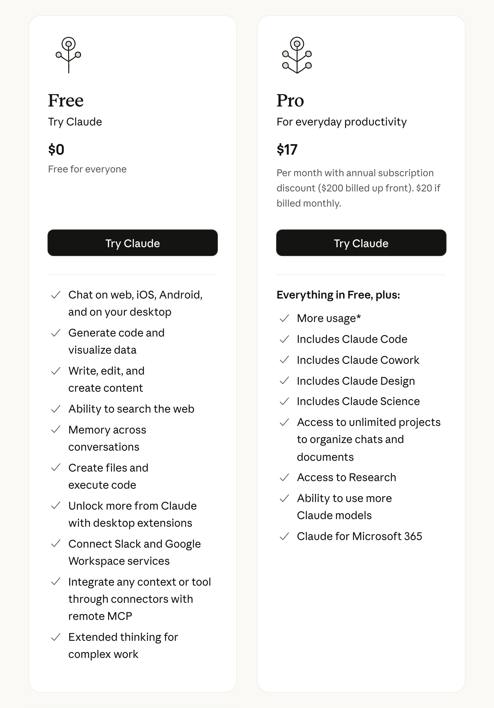
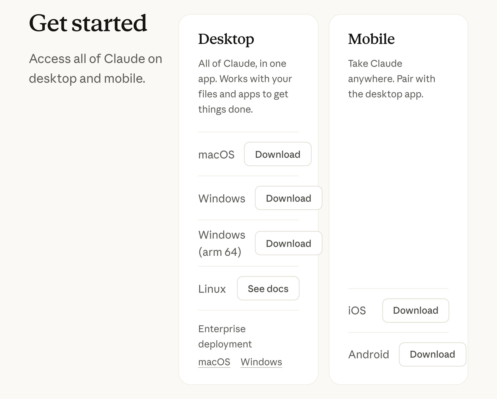
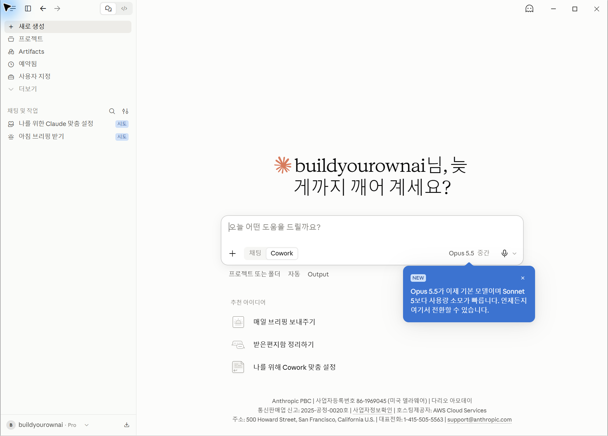
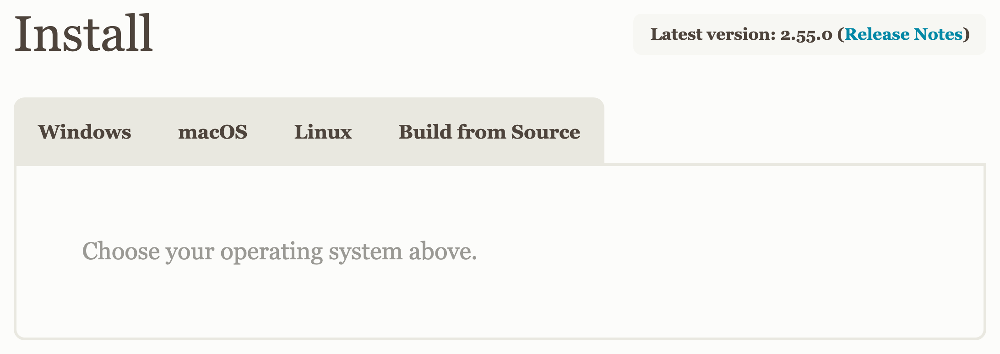

# Claude Desktop·Git 설치와 첫 로그인

## 시작하기 전에 요금제를 확인합니다

Claude Desktop의 설치와 Claude Code의 이용 조건은 구분해야 합니다.
앱은 무료로 설치할 수 있지만, **이 책의 실습에는 Claude Code를 사용할 수
있는 요금제**가 필요합니다.

요금제의 포함 범위는 바뀔 수 있으므로 결제하기 전에 아래 공식 요금 페이지에서 Claude Code가 포함되는지 확인합니다.
처음부터 상위 플랜을 선택하기보다, 사용할 수 있는 기능과 사용량을
확인하고 시작합니다.

요금제와 제공 기능, 사용량 정책은 바뀔 수 있습니다. 결제하기 전에 공식
요금 페이지에서 현재 Claude Code가 포함된 개인용 플랜을 확인합니다.

> [!원칙]
> **공식 요금 페이지**
>
> `https://claude.com/pricing`

Claude Code에는 사용량 한도가 있습니다. 한도에 도달하면 화면에
안내된 재사용 시점을 확인하고 기다렸다가 작업을 이어갑니다.

> [!주의]
> **추가 설정은 지금 필요하지 않습니다**
>
> 인터넷에는 별도의 개발자용 설정이나 결제 방법을 안내하는 글도 있지만,
> **이 책의 첫 실습에는 필요하지 않습니다.**
>
> 지금은 Claude Code를 사용할 수 있는 요금제만 준비합니다.
>
> **추가 비용이 생길 수 있는 기능은 실제로 필요해질 때 확인한 뒤
> 사용합니다.**

뒤에서는 GitHub, Vercel, Supabase, Google Cloud 같은 서비스도 사용합니다.
이 책의 실습은 **개인 계정**을 기준으로 진행합니다.

실습 전체가 무료인 것은 아닙니다. Claude Code 요금제와 별도로, 16장의 Kling 이미지·영상 제작에는 유료 이용과 생성 크레딧이 필요합니다. Gemini 등 외부 서비스의 비용과 사용량 한도도 각각 확인합니다. 처음부터 모두 결제하지 않고, 필요한 장에 도착했을 때 현재 조건과 예산을 보고 결정합니다.

Claude Code를 사용할 수 있는 요금제를 확인했다면 이제 설치를 시작합니다.

---

## Claude Desktop을 설치합니다

웹 브라우저에서 Anthropic의 공식 Claude 다운로드 페이지로 이동합니다.

> [!원칙]
> **공식 다운로드**
>
> `https://claude.com/download`

> [!주의]
> **QR 코드는 공식 페이지를 확인할 때 사용하세요. 실제 설치는 이 책을
> 실습할 컴퓨터에서 진행합니다.**

Windows를 사용한다면 Windows용을, Mac을 사용한다면 macOS용을 선택합니다.
사용하는 컴퓨터에 맞는 설치 파일을 선택합니다. 이 문서의 과거 화면과 현재 설치 조건은 다를 수 있습니다.

설치가 끝나면 Claude Desktop을 실행합니다.

> [!주의]
> **책과 화면 모양이 조금 달라도 괜찮습니다**
>
> 이 책에는 Windows와 macOS에서 촬영한 화면이 함께 나옵니다. 또한
> Claude Desktop과 Claude Code는 계속 업데이트되므로 버튼 모양이나
> 위치가 책과 조금 다를 수 있습니다.
>
> 운영체제에 따라 실제 조작이 달라지는 곳은 본문에서 각각 안내합니다.
> 별도 안내가 없다면 현재 사용 중인 운영체제와 Claude Desktop의 Code
> 탭에서 그대로 진행하면 됩니다.

---

## Claude에 로그인합니다

Claude Desktop을 실행하면 로그인이 필요합니다.

기존 계정이 있다면 로그인하고, 처음 사용하는 경우에는 화면 안내에 따라
계정을 준비합니다.

로그인이 끝나면 화면 왼쪽 위에서 **Code**를 선택합니다. 그 옆에는 일반
대화로 이동하는 항목도 함께 보입니다.

**Code**를 눌렀을 때 유료 플랜 안내가 나오면 먼저 요금제를 준비한
계정으로 로그인했는지 확인합니다. 계정이 맞는데 이용 가능한 플랜이
없다면 앞의 요금 페이지를 확인한 뒤 Claude Desktop을 다시 실행합니다.

웹 브라우저에서 로그인을 요구하면 안내에 따라 완료한 뒤 Claude Desktop을
다시 실행합니다.

회사나 조직에서 제공하는 환경은 화면이나 기능이 다를 수 있습니다. 이
책에서는 **일반 사용자가 직접 사용하는 환경**을 기준으로 설명합니다.

---

## 앞으로 사용할 Git을 미리 준비합니다

앞으로 잘되던 상태를 기록하고, 무엇이 바뀌었는지 비교하고, 필요할 때
이전 상태로 되돌리기 위해 **Git**을 사용합니다.

지금은 사용법을 배우지 않습니다. 필요한 환경만 준비해둡니다.

> [!원칙]
> **공식 다운로드**
>
> `https://git-scm.com/downloads`

> [!주의]
> **QR 코드는 공식 페이지를 확인할 때 사용하세요. 실제 설치는 이 책을
> 실습할 컴퓨터에서 진행합니다.**

운영체제에 따라 준비 방법이 다릅니다.

**Windows를 사용한다면 지금 설치합니다.** Claude Desktop이 내 컴퓨터의 파일을
직접 다루는 `로컬` 환경을 사용하려면 Windows에서는 Git이 필요합니다. Windows용 Git을 내려받아
설치하고, 설치 항목은 **기본값을 그대로 두고** 진행합니다.

설치가 끝나면 Claude Desktop을 다시 실행합니다.

**Mac을 사용한다면 지금은 아무것도 내려받지 않습니다.** Git이 이미
준비되어 있는지는 잠시 뒤 Claude Code에게 확인합니다.

Git은 5장에서 실제로 필요해질 때 사용합니다.

---
