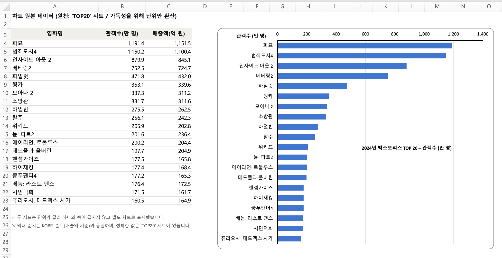

# 1장. 영화 흥행 기록으로 첫 Excel 보고서를 만들어봅니다

## 이 장에서 만드는 것

이 장을 끝내면 movie-report-2024.xlsx 파일 하나가 생깁니다. 공식 KOBIS 자료를 찾아
2024년 영화 흥행 기록을 정리한 Excel 보고서입니다.



저자가 실제로 만든 파일을
[여기서 내려받아 열어보실 수 있습니다](../../verification/chapter-01/artifacts/movie-report-2024.xlsx).
그 파일은 시트 4개로 이루어져 있습니다.

| 시트 | 내용 |
|---|---|
| TOP20 | 순위·영화명·개봉일·관객수·매출액 20행과 합계 행 |
| 차트 | 관객수·매출액 막대 차트 2개. TOP20 시트의 실제 셀을 참조합니다 |
| 요약 | 조회 조건과 핵심 요약. 각 항목에 산출 방식이 함께 적혀 있습니다 |
| 출처 | 조회 URL·기준 연도·수집 일시·재확인 방법 |

시트 이름과 표가 시작하는 행은 실행할 때마다 달라집니다. 여러분의 보고서가 이 파일과
다르게 생겼어도 괜찮습니다. 책 1장의 확인 목록 7개가 보이면 제대로 만들어진 것입니다.

## 프롬프트

[prompts.md](prompts.md)에 1장에서 Claude Code에 입력하는 문장이 책의 순서대로 있습니다.

## 장별 Source

[source/movie-report/](source/movie-report/)는 1장을 끝낸 상태의 프로젝트입니다. 실습이
잘 진행되는 동안 먼저 열어보는 정답지가 아니라, 아래 복구 방법으로도 해결하지 못했을 때
다음 장부터 이어가기 위한 마지막 수단입니다.

## 검증 결과

저자는 서로 독립된 빈 폴더 3개에서 1장을 처음부터 돌렸고, 확인 목록 7개를 3회 모두
통과했습니다. 보고서에 담긴 20편의 영화명·관객수·매출액은 KOBIS 공식통계와 대조해
일치를 확인했습니다. 근거는
[verification/chapter-01/](../../verification/chapter-01/)에 있습니다.

## 막혔을 때

```text
디버깅 → 내 정상 기록으로 복구 → 장별 Source로 재시작
```

Git 명령을 외우거나 직접 입력할 필요는 없습니다. 아래 요청문을 그대로 붙여넣으면
Claude Code가 확인하고 처리합니다.

**1. 디버깅** — 먼저 무엇이 어긋났는지 그대로 말하고 고쳐봅니다. 대부분 여기서
해결됩니다.

```text
지금 작업이 책과 다르게 진행됐어.
현재 상태와 화면에 나온 문제를 확인하고 원인을 찾아서 고쳐줘.
```

**2. 내 정상 기록으로 복구** — 해결되지 않으면 실습하면서 내 프로젝트에 남겨둔 정상
기록으로 돌아갑니다. 지금까지 한 작업은 먼저 따로 보존합니다.

```text
현재 작업은 잃지 않도록 먼저 별도로 보존해줘.
이 프로젝트에서 마지막으로 정상 동작했던 상태를 찾아 안전하게 복구해줘.
```

**3. 장별 Source로 재시작** — 그래도 이어갈 수 없을 때 사용합니다. 1장의 남은 실습은
건너뛰게 되므로 마지막 수단입니다.

```text
내 현재 작업을 먼저 안전하게 보존해줘.
아래 1장 완성 Source에서 다시 시작해줘.
https://github.com/buildyourownai-lab/develop-like-a-pro-with-ai/tree/main/chapters/ch01/source/movie-report
준비가 끝나면 1장을 마친 상태인지 확인해줘.
```
