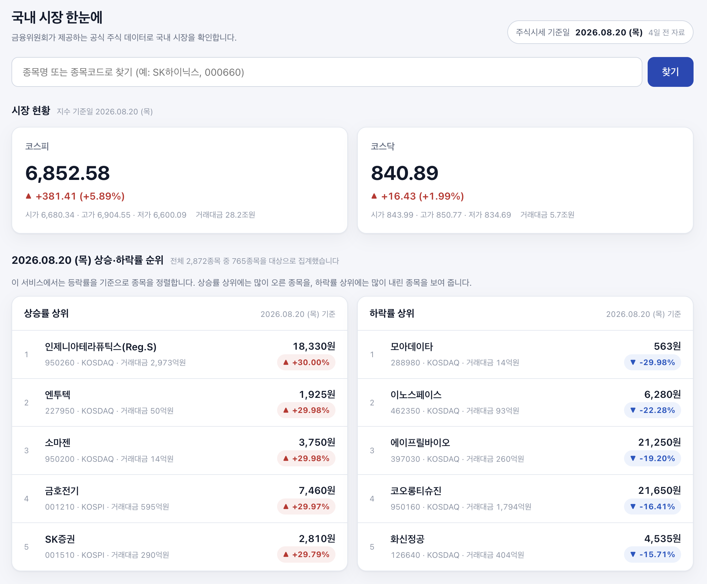
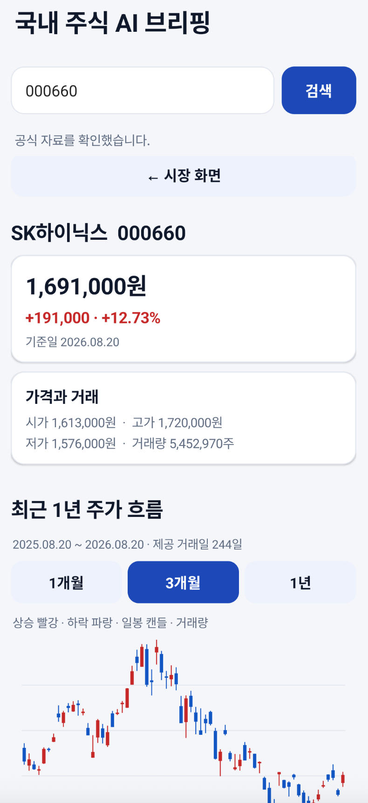
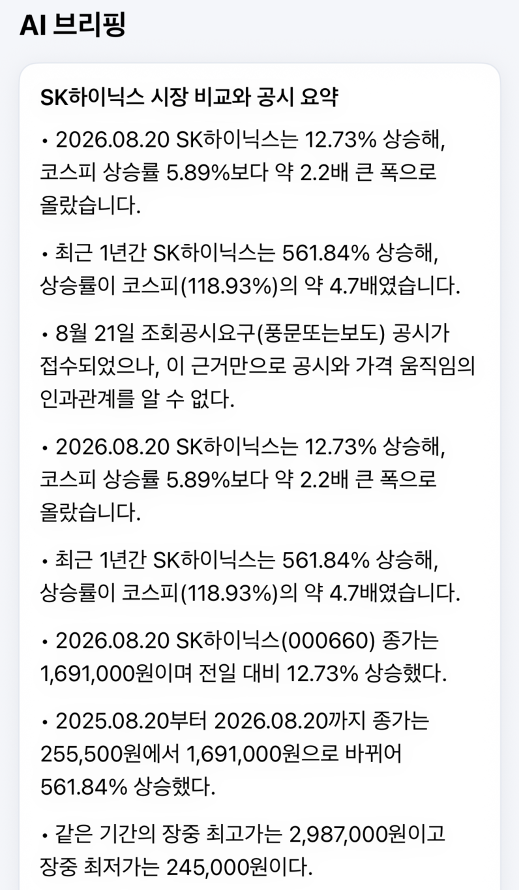

<p align="left"></p>


[](https://ai-stock-briefing.vercel.app)
[](tests/unit/)

`ai-stock-briefing`은 PART 3의 9–12장 웹서비스와 PART 4의 13–15장 모바일 앱을 함께 관리하는 공식 프로젝트 저장소입니다. 금융위원회 공식 시장 데이터와 OpenDART 공시를 모아 Gemini가 근거 범위 안에서 브리핑합니다.

## 서비스

### 웹

[ai-stock-briefing.vercel.app](https://ai-stock-briefing.vercel.app)

<a href="https://ai-stock-briefing.vercel.app"></a>

### 모바일 앱

<table>
  <tr>
    <th align="center">Android · 종목 상세</th>
    <th align="center">iPhone · AI 브리핑</th>
  </tr>
  <tr>
    <td width="50%"><a href="assets/screenshots/android-stock-detail.png"></a></td>
    <td width="50%"><a href="assets/screenshots/iphone-ai-briefing.png"></a></td>
  </tr>
</table>

## 장별 범위

- 9장: 시장 현황, 급등락, 종목 검색과 상세
- 10장: OpenDART 공시와 원문 연결
- 11장: 시장·공시 Evidence Packet을 사용한 Gemini 브리핑
- 12장: Supabase·Redis Cache로 속도·호출 제한·비용 개선
- 13장: 모바일 확장 판단과 API 계약
- 14장: `android/` Android 앱
- 15장: `ios/` iPhone 앱

이 서비스는 실시간 시세나 투자 추천 서비스가 아닙니다. 데이터 기준일을 화면에 표시하고 매수·매도 추천, 목표주가, 예측, 투자 점수를 만들지 않습니다.

## 환경변수

```text
DATA_GO_KR_SERVICE_KEY
OPEN_DART_API_KEY
GEMINI_API_KEY
GEMINI_MODEL
```

Secret은 `.env.local` 또는 배포 환경변수에만 두고 브라우저·앱·Git에 넣지 않습니다.

## 웹 실행

```bash
npm install
npm run dev
npm run build
npm start
```

## 테스트

```bash
npm test
npm run lint
npm run build
npm run test:web
npm run test:regression
npm run test:golden-path
npm run test:api
npm run test:chapter11:e2e
npm run test:chapter12:e2e
npm run test:chapter14:api
npm run test:part3
npm run scan:secrets
```

Playwright 테스트는 최신 Production Build를 사용하므로 먼저 `npm run build`를 실행합니다.

장별 실제 서비스 측정 근거는 [중앙 공개 검증 기록](https://github.com/buildyourownai-lab/develop-like-a-pro-with-ai/blob/main/verification/chapter-12/README.md)에서 확인할 수 있습니다.

## 모바일 빌드

```bash
cd android
./gradlew assembleDebug lintDebug

cd ../ios
swift test
```

Android Debug는 `http://10.0.2.2:3000`의 로컬 서버에 연결합니다. Release는 HTTPS 서버 주소를 설정하기 전에는 사용하지 않습니다.

## 최종 프로젝트

책에서 만드는 프로젝트의 최신 구현은 다음 개별 저장소에서 관리합니다.

<table width="100%">
  <thead>
    <tr>
      <th align="center" width="90">PART</th>
      <th align="center" width="90">장</th>
      <th align="center" width="223">저장소</th>
      <th align="center" width="326">내용</th>
    </tr>
  </thead>
  <tbody>
    <tr>
      <td align="center" width="90">1</td>
      <td align="center" width="90">1–5</td>
      <td align="left" width="223"><a href="https://github.com/buildyourownai-lab/movie-report"><code>movie-report</code></a></td>
      <td align="left" width="326">영화 흥행 보고서</td>
    </tr>
    <tr>
      <td align="center" width="90">2</td>
      <td align="center" width="90">6–8</td>
      <td align="left" width="223"><a href="https://github.com/buildyourownai-lab/apartment-explorer"><code>apartment-explorer</code></a></td>
      <td align="left" width="326">아파트 탐색 서비스</td>
    </tr>
    <tr>
      <td align="center" width="90">3</td>
      <td align="center" width="90">9–12</td>
      <td align="left" width="223"><a href="https://github.com/buildyourownai-lab/ai-stock-briefing"><code>ai-stock-briefing</code></a></td>
      <td align="left" width="326">국내주식 AI 브리핑 웹서비스</td>
    </tr>
    <tr>
      <td align="center" width="90">4</td>
      <td align="center" width="90">13–15</td>
      <td align="left" width="223"><a href="https://github.com/buildyourownai-lab/ai-stock-briefing"><code>ai-stock-briefing</code></a></td>
      <td align="left" width="326">Android·iPhone 앱</td>
    </tr>
    <tr>
      <td align="center" width="90">5</td>
      <td align="center" width="90">16–18</td>
      <td align="left" width="223"><a href="https://github.com/buildyourownai-lab/ai-shorts-maker"><code>ai-shorts-maker</code></a></td>
      <td align="left" width="326">AI 쇼츠 제작</td>
    </tr>
    <tr>
      <td align="center" width="90">6</td>
      <td align="center" width="90">19–22</td>
      <td align="left" width="223"><a href="https://github.com/buildyourownai-lab/ai-media-works"><code>ai-media-works</code></a></td>
      <td align="left" width="326">AI 미디어 운영</td>
    </tr>
  </tbody>
</table>

## 문의 [](https://github.com/buildyourownai-lab/ai-stock-briefing/issues)

자료 오류와 실습 문제는 [GitHub Issues](https://github.com/buildyourownai-lab/ai-stock-briefing/issues)에 남겨주세요.
